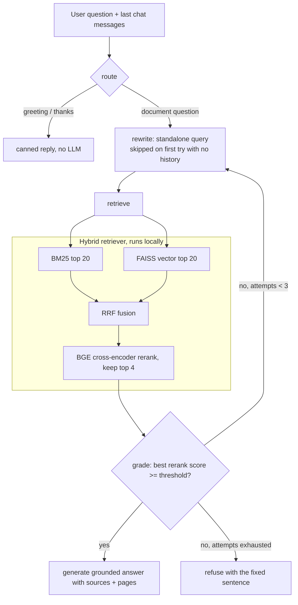

# Agentic RAG Chatbot — Study Notes Assistant

A chatbot that answers questions from technical PDFs (here: Data Structures lecture notes). It combines **hybrid retrieval** (BM25 keyword search + FAISS vector search, merged with Reciprocal Rank Fusion), a **BGE cross-encoder reranker**, and a **LangGraph agent** that rewrites questions, checks result quality, retries with a new query, and refuses when the notes do not contain the answer. Every answer lists its sources with file name and page number.

**What runs where.** Embeddings, retrieval and reranking run locally on CPU. Only answer generation is hosted: it calls the Hugging Face Inference API with a model you choose in `.env`. A free Hugging Face token is required; there is no OpenAI or Pinecone dependency.

> **Status.** Code, API, chat UI, tests and Dockerfile are in place. The generation-side evaluation (faithfulness, refusal accuracy, the agent variant) has **not been run yet** because the Hugging Face free credits were exhausted, so those cells are empty below instead of guessed. Azure deployment is planned, not done.

---

## Architecture



Grading uses the reranker score, not another LLM call, which keeps free-tier usage low: 1 LLM call for a clear question, 2 for a follow-up, about 4 in the worst retry case.

Offline (run once per set of PDFs): PDF text extraction (pypdf, pdfminer fallback) → text cleaning → chunking → local embeddings → FAISS index + `chunks.json` for BM25, saved in `vectorstore/`.

## Project layout

```
app.py                  Gradio chat page (mounted into FastAPI)
src/
  config.py             all settings read from .env
  ingest.py             load, clean, chunk, embed, save index + chunks.json
  retriever.py          BM25 + vector + RRF + BGE reranker
  llm.py                HF chat call with retry, backoff, fallback model
  agent.py              LangGraph agent (route, rewrite, retrieve, grade, generate, refuse)
  api.py                FastAPI: /chat, /health, plus the chat page
  calibrate.py          picks RERANK_THRESHOLD from data
  evaluate.py           3-variant evaluation + LLM judge
  metrics.py            hit@k, MRR, refusal and summary helpers
  query.py              the original naive pipeline (evaluation baseline A)
tests/                  pytest suite (no network or models needed)
eval_data/              30 test questions with gold pages, calibration set, reports
data/pdfs/              the PDFs to index
Dockerfile, .dockerignore, docker-compose.yml
```

## Setup

```bash
python -m venv venv
venv\Scripts\activate            # Windows   (Mac/Linux: source venv/bin/activate)
pip install -r requirements.txt  # CPU-only PyTorch via the extra index in the file
copy .env.example .env           # Windows   (Mac/Linux: cp .env.example .env)
```

Edit `.env`: set `HUGGINGFACEHUB_API_TOKEN` (free "Read" token from huggingface.co/settings/tokens), `GENERATION_MODEL`, an optional `FALLBACK_MODEL`, and a `JUDGE_MODEL` that is **different** from the generator. Then check the token and build the index:

```bash
python scripts/test_hf_token.py
python src/ingest.py             # writes vectorstore/index.faiss, index.pkl, chunks.json
```

## Run

```bash
uvicorn src.api:app --port 8000
```

| URL | What |
|---|---|
| `http://127.0.0.1:8000/` (redirects to `/ui`) | Chat page: sources under each answer, collapsible agent trace |
| `POST /chat` | `{"question": "...", "history": [{"role": "user", "content": "..."}]}` → answer, sources with pages, chunk previews, trace, latency |
| `GET /health` | model name, index loaded, reranker loaded |
| `/docs` | Swagger UI |

The first start loads FAISS, BM25 and the reranker (tens of seconds on CPU). Each retrieval reranks up to 40 candidates on CPU, about 6–10 s per query on the development laptop.

Safety knobs in `.env`: `CORS_ORIGINS` (comma-separated, default localhost only), `RATE_LIMIT_PER_MIN` (default 20 per IP on `/chat`), `APP_PASSWORD` (enables a login for the chat page, user `demo`). Errors return generic messages; details go to the server log, and question text is never logged.

## Configuration

All variables are optional except the token. See `.env.example` for comments.

| Variable | Default | Purpose |
|---|---|---|
| `HUGGINGFACEHUB_API_TOKEN` | – | HF Inference API access |
| `GENERATION_MODEL` / `FALLBACK_MODEL` | gemma-2-9b-it / – | answer model; fallback used when it is not served |
| `JUDGE_MODEL` | – | evaluation judge, must differ from the generator |
| `EMBEDDING_MODEL` | all-MiniLM-L6-v2 | local embeddings |
| `RERANKER_MODEL` | BAAI/bge-reranker-base | cross-encoder |
| `CHUNK_SIZE` / `CHUNK_OVERLAP` | 1000 / 150 | chunking |
| `K_EACH` / `TOP_N` | 20 / 4 | candidates per retriever / final chunks |
| `BM25_WEIGHT` / `VECTOR_WEIGHT` | 0.5 / 0.5 | fusion weights |
| `RERANK_THRESHOLD` | 0.0 (`.env.example`: 0.05) | below this the agent retries, then refuses |
| `MAX_ATTEMPTS` / `HISTORY_TURNS` | 3 / 4 | searches per question / messages the agent sees |

### Calibrating the threshold

`RERANK_THRESHOLD` should come from your data, not a guess:

```bash
python -m src.calibrate
```

It scores 20 answerable and 10 unanswerable questions (`eval_data/calibration_questions.json`) and suggests a value (0.05 on the shipped PDFs: 100% of answerable questions pass, 90% of unanswerable are refused). One unanswerable question (a TCP question) still scored 0.96 and would be answered, so a single threshold cannot catch everything.

## Evaluation

`eval_data/test_questions.json` has 30 questions: 21 answerable (19 standalone, 2 follow-ups with chat history, each with its gold PDF page) and 9 the PDFs cannot answer. Three variants run on the same questions:

| Variant | What it is |
|---|---|
| A: Naive | vector search only, top 4, straight to the LLM (the original system) |
| B: Hybrid + rerank | BM25 + vector + RRF + BGE reranker, top 4, straight to the LLM |
| C: Agentic | the full LangGraph agent |

```bash
python -m src.evaluate                    # all variants + judge (needs HF credits)
python -m src.evaluate --retrieval-only   # hit@4 and MRR for A and B, no LLM calls
python -m src.evaluate --variants A,B --no-judge
```

Metrics: hit@4 and MRR (is a gold page among the final 4 chunks), faithfulness (1–5 from an LLM judge), refusal accuracy, wrong refusals, errors, latency and LLM calls. Each average is shown with the number of questions behind it; a pipeline error is counted as an error, never dropped or scored as a 1. Judge scores are directional only — spot-check about 10 answers by hand.

### Results

| Variant | Hit@4 | MRR | Faithfulness | Refusal correct | Wrong refusals | Errors |
|---|---|---|---|---|---|---|
| A: Naive | 95% (20/21) | 0.81 | not run | not run | not run | not run |
| B: Hybrid + rerank | 100% (21/21) | 0.93 | not run | not run | not run | not run |
| C: Agentic | not run | not run | not run | not run | not run | not run |

Hit@4 and MRR are from a real retrieval-only run. Limits: 21 answerable questions is small, the questions were written from the same PDFs, and both variants are near the ceiling, so the MRR gap is the more informative number. Hybrid + rerank costs about 8 s per query on CPU against about 0.01 s for plain vector search. The "not run" cells will be replaced by numbers from a real `python -m src.evaluate` run.

## Tests

```bash
python -m pytest -q
```

53 tests, no network or model downloads: text cleaning, retrieval and fusion logic, agent routing (greeting, retry, refusal after 3 weak searches, fallback query), the LLM wrapper's retry/backoff/fallback with a mocked client, API behaviour (sources with pages, safe errors, rate limit, CORS), judge parsing and metrics.

## Docker

```bash
docker build -t rag-qa .
docker run --rm -p 8000:8000 --env-file .env rag-qa
curl http://localhost:8000/health
```

The image installs CPU-only PyTorch, downloads the embedding model and the BGE reranker at **build** time, copies `data/pdfs/` and runs `src/ingest.py` during the build, so the index is baked in and containers start without downloads. It runs as a non-root user, keeps `.env` out of the image (`.dockerignore`), and takes the token only at runtime. `PORT` (default 8000) sets the listening port. Expect an image of roughly 2 GB. Only build with PDFs you are allowed to publish.

`docker compose up --build` does the same with `.env` loaded; it deliberately mounts no volumes, since a mounted `vectorstore/` would hide the baked-in index.

> The Dockerfile has not been built or run on this machine yet (the Docker daemon was not running), so treat it as untested until `docker build` and a `/health` check pass.

## Planned next

Azure Container Apps deployment with GitHub Actions CI/CD (scale-to-zero, secrets in Container Apps, budget alert), the full evaluation run above, and the ablations (chunk size, k, BM25 weight, embedding model).

## Limits

- Answers depend on a small hosted model; faithfulness scores come from another small model and are directional.
- Retrieval quality was measured on 21 questions from one document set.
- The reranker is slow on CPU and overconfident on some out-of-scope questions (see calibration).
- Scanned PDFs without a text layer are not supported (no OCR).
