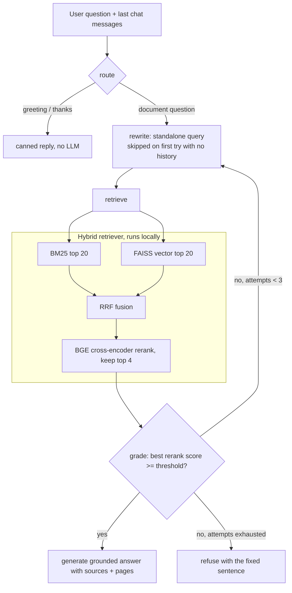

# Agentic RAG Chatbot — Data Structures & Algorithms Assistant

A chatbot that answers **Data Structures and Algorithms** questions from a knowledge base made of your own lecture-note PDFs plus 72 Wikipedia articles on the subject (fetched automatically, so nothing has to be uploaded). Answers always come from retrieved text; questions on other topics are politely declined. It combines **hybrid retrieval** (BM25 keyword search + FAISS vector search, merged with Reciprocal Rank Fusion), a **BGE cross-encoder reranker**, and a **LangGraph agent** that rewrites questions, checks result quality, retries with a new query, and refuses when the knowledge base does not contain the answer. Every answer lists its sources (PDF file and page, or the Wikipedia article).

**What runs where.** Embeddings, retrieval and reranking run locally on CPU. Only answer generation is hosted: it calls the Hugging Face Inference API (or any OpenAI-compatible provider, see Configuration) with a model you choose in `.env`. There is no OpenAI or Pinecone dependency.

> **Status.** Code, API, chat UI, tests and a Dockerfile are in place. The evaluation is being re-run on the expanded knowledge base (see Results); the Dockerfile has not been built successfully on the development machine yet, and no cloud deployment has been done.

---

## Architecture



Grading uses the reranker score, not another LLM call, which keeps free-tier usage low: 1 LLM call for a clear question, 2 for a follow-up, about 4 in the worst retry case.

Offline (run once per set of PDFs): PDF text extraction (pypdf, pdfminer fallback) → text cleaning → chunking → local embeddings → FAISS index + `chunks.json` for BM25, saved in `vectorstore/`.

## Project layout

```
app.py                  Gradio chat page (mounted into FastAPI)
src/
  config.py             all settings read from .env
  fetch_corpus.py       downloads the Wikipedia DS/Algorithms articles into data/corpus/
  ingest.py             load PDFs + corpus, clean, chunk, embed, save index + chunks.json
  retriever.py          BM25 + vector + RRF + BGE reranker
  llm.py                HF chat call with retry, backoff, fallback model
  agent.py              LangGraph agent (route, rewrite, retrieve, grade, generate, refuse)
  api.py                FastAPI: /chat, /health, plus the chat page
  calibrate.py          picks RERANK_THRESHOLD from data
  evaluate.py           3-variant evaluation + LLM judge
  metrics.py            hit@k, MRR, refusal and summary helpers
  query.py              the original naive pipeline (evaluation baseline A)
tests/                  pytest suite (no network or models needed)
eval_data/              42 test questions with gold sources, calibration set, reports
data/pdfs/              your lecture-note PDFs
data/corpus/            Wikipedia articles as .txt (CC BY-SA, see data/corpus/README.md)
Dockerfile, .dockerignore, docker-compose.yml
```

## Setup

```bash
python -m venv venv
venv\Scripts\activate            # Windows   (Mac/Linux: source venv/bin/activate)
pip install -r requirements.txt  # CPU-only PyTorch via the extra index in the file
copy .env.example .env           # Windows   (Mac/Linux: cp .env.example .env)
```

Edit `.env`: set `HUGGINGFACEHUB_API_TOKEN` (free "Read" token from huggingface.co/settings/tokens), `GENERATION_MODEL`, an optional `FALLBACK_MODEL`, and a `JUDGE_MODEL` that is **different** from the generator. Then check the token and build the index:

```bash
python scripts/test_hf_token.py
python -m src.fetch_corpus       # optional: re-download the Wikipedia articles (already in data/corpus/)
python src/ingest.py             # writes vectorstore/index.faiss, index.pkl, chunks.json
```

Add your own PDFs to `data/pdfs/` and re-run `ingest.py` to include them; the corpus articles are indexed alongside.

## Run

```bash
uvicorn src.api:app --port 8000
```

| URL | What |
|---|---|
| `http://127.0.0.1:8000/` (redirects to `/ui`) | Chat page: sources under each answer, collapsible agent trace |
| `POST /chat` | `{"question": "...", "history": [{"role": "user", "content": "..."}]}` → answer, sources with pages, chunk previews, trace, latency |
| `GET /health` | model name, index loaded, reranker loaded |
| `/docs` | Swagger UI |

The first start loads FAISS, BM25 and the reranker (tens of seconds on CPU). Each retrieval reranks up to 40 candidates on CPU, about 6–10 s per query on the development laptop.

Safety knobs in `.env`: `CORS_ORIGINS` (comma-separated, default localhost only), `RATE_LIMIT_PER_MIN` (default 20 per IP on `/chat`), `APP_PASSWORD` (enables a login for the chat page, user `demo`). Errors return generic messages; details go to the server log, and question text is never logged.

## Configuration

All variables are optional except the token. See `.env.example` for comments.

| Variable | Default | Purpose |
|---|---|---|
| `HUGGINGFACEHUB_API_TOKEN` | – | HF Inference API access |
| `GENERATION_MODEL` / `FALLBACK_MODEL` | gemma-2-9b-it / – | answer model; fallback used when it is not served |
| `LLM_BASE_URL` / `LLM_API_KEY` | – | optional: use any OpenAI-compatible provider (Groq, Gemini, OpenRouter...) instead of Hugging Face, e.g. when HF credits run out (HTTP 402). The model variables then name that provider's models |
| `JUDGE_MODEL` | – | evaluation judge, must differ from the generator |
| `EMBEDDING_MODEL` | all-MiniLM-L6-v2 | local embeddings |
| `RERANKER_MODEL` | BAAI/bge-reranker-base | cross-encoder |
| `CHUNK_SIZE` / `CHUNK_OVERLAP` | 1000 / 150 | chunking |
| `K_EACH` / `TOP_N` | 20 / 4 | candidates per retriever / final chunks |
| `BM25_WEIGHT` / `VECTOR_WEIGHT` | 0.5 / 0.5 | fusion weights |
| `RERANK_THRESHOLD` | 0.0 (`.env.example`: 0.3) | below this the agent retries, then refuses; a score below a tenth of it refuses at once |
| `MAX_ATTEMPTS` / `HISTORY_TURNS` | 3 / 4 | searches per question / messages the agent sees |

### Calibrating the threshold

`RERANK_THRESHOLD` should come from your data, not a guess:

```bash
python -m src.calibrate
```

It scores 32 answerable and 15 unanswerable questions (`eval_data/calibration_questions.json`) and suggests a value. On the current knowledge base it suggested 0.64 (answerable scores were all at least 0.675), but two off-topic questions scored high (a TCP question 0.998, a boiling-point question 0.607), so no threshold separates everything. I set 0.3 instead: a lower value avoids wrongly refusing real Data Structures questions, and the answer prompt also refuses off-topic questions as a second guard. That is a judgement call, not a measured optimum.

## Evaluation

`eval_data/test_questions.json` has 42 questions: 33 answerable and 9 off-topic. 21 answerable questions come from the lecture notes (19 standalone, 2 follow-ups with chat history; gold = the right PDF page or the matching Wikipedia article) and 12 are general Data Structures questions answered only by the Wikipedia corpus (gold = that article). Three variants run on the same questions:

| Variant | What it is |
|---|---|
| A: Naive | vector search only, top 4, straight to the LLM (the original system) |
| B: Hybrid + rerank | BM25 + vector + RRF + BGE reranker, top 4, straight to the LLM |
| C: Agentic | the full LangGraph agent |

```bash
python -m src.evaluate                    # all variants + judge (needs HF credits)
python -m src.evaluate --retrieval-only   # hit@4 and MRR for A and B, no LLM calls
python -m src.evaluate --variants A,B --no-judge
```

Metrics: hit@4 and MRR (is a gold page among the final 4 chunks), faithfulness (1–5 from an LLM judge), refusal accuracy, wrong refusals, errors, latency and LLM calls. Each average is shown with the number of questions behind it; a pipeline error is counted as an error, never dropped or scored as a 1. Judge scores are directional only — spot-check about 10 answers by hand.

### Results

**The 42-question run on the current knowledge base (notes + Wikipedia) is in progress; its numbers will be added here from the real run.** Until then, the table below is an *earlier* run: the notes-only index and the earlier 30-question set (21 answerable, 9 unanswerable), before the Wikipedia corpus, the scope prompt and the 0.3 threshold existed. Those numbers do not describe the current system. Generator `qwen/qwen3.8-27b`, judge `openai/gpt-oss-120b` (a different model), both via Groq. 0 pipeline errors in every variant.

| Variant | Hit@4 | MRR | Faithfulness (1-5) | Refusal correct | Wrong refusals | Errors | Avg latency | Avg LLM calls |
|---|---|---|---|---|---|---|---|---|
| A: Naive | 95% (20/21) | 0.81 | 4.81 (n=21) | 100% (9/9) | 0/21 | 0/30 | 8.6 s | 1.00 |
| B: Hybrid + rerank | 100% (21/21) | 0.93 | 5.00 (n=19) | 100% (9/9) | 2/21 | 0/30 | 12.0 s | 1.00 |
| C: Agentic | 100% (21/21) | 0.95 | 5.00 (n=21) | 100% (9/9) | 0/21 | 0/30 | 16.3 s | 1.23 |

Faithfulness is judged only for answers a variant actually gave (B's n=19 because it refused two answerable questions).

**What the numbers say**

- **Retrieval:** hybrid search plus reranking lifts MRR from 0.81 to 0.93 (hit@4 from 95% to 100%); the agent adds a little more (0.95).
- **Follow-up questions are where the agent matters.** B has no query rewriting, so it refused both follow-ups ("What operations does it support?", "How does it differ from a singly linked list?") even though it retrieved the right page. A, with the same problem, answered the first one about the wrong structure (linked list instead of stack) and the judge gave it a 1. That single answer is the whole reason A's faithfulness is 4.81 instead of 5.0. C rewrites the question from the chat history and answered both correctly.
- **Refusal:** all three variants refused all 9 out-of-scope questions, so on this set the reranker-score gate did not improve refusal accuracy; the prompt alone was enough for this generator. The gate's benefit here is skipping the answer call (1.23 average LLM calls for C).
- **Cost:** the agent is the slowest. Refused questions take about 21 s for C because it runs 3 searches.

**Limits, stated plainly**

- 21 answerable and 9 unanswerable questions is small, and I wrote them from the same PDFs. Most are easy, so faithfulness sits at the ceiling and the differences between variants are small except on follow-ups, of which there are only 2.
- Judge scores come from one small model and are directional. I spot-checked the follow-up answers and the one low score by hand; the rest were not individually read.
- Latencies are noisy: the evaluation shared the machine with a running web server, browser tests and an earlier Docker build, and the CPU reranker dominates. Treat them as ordering, not benchmarks.
- Retrieval is scored by gold page (pypdf 0-indexed in the eval files; the app shows 1-indexed PDF pages).

## Tests

```bash
python -m pytest -q
```

67 tests, no network or model downloads: text cleaning, retrieval and fusion logic, agent routing (greeting, retry, refusal after 3 weak searches, fallback query), the LLM wrapper's retry/backoff/fallback with a mocked client, API behaviour (sources with pages, safe errors, rate limit, CORS), judge parsing and metrics.

## Docker

```bash
docker build -t rag-qa .
docker run --rm -p 8000:8000 --env-file .env rag-qa
curl http://localhost:8000/health
```

The image installs CPU-only PyTorch, downloads the embedding model and the BGE reranker at **build** time, copies `data/pdfs/` and `data/corpus/` and runs `src/ingest.py` during the build, so the index is baked in and containers start without downloads. It runs as a non-root user, keeps `.env` out of the image (`.dockerignore`), and takes the token only at runtime. `PORT` (default 8000) sets the listening port. Expect an image of roughly 2 GB. Only build with PDFs you are allowed to publish.

`docker compose up --build` does the same with `.env` loaded; it deliberately mounts no volumes, since a mounted `vectorstore/` would hide the baked-in index.

> The Dockerfile has not been built successfully on the development machine yet: three attempts failed while downloading Python packages (PyPI read timeouts), before any of the project's own build steps ran. Treat it as untested until `docker build` and a `/health` check pass.

## Planned next

Cloud deployment (Render or Hugging Face Spaces; the earlier Azure plan was dropped), faster reranking (fewer candidates or a smaller reranker), a larger and harder test set, and the ablations (chunk size, k, BM25 weight, embedding model).

## Limits

- Answers depend on a small hosted model; faithfulness scores come from another small model and are directional.
- Retrieval quality was measured on 21 questions from one document set.
- The reranker is slow on CPU and overconfident on some out-of-scope questions (see calibration).
- Scanned PDFs without a text layer are not supported (no OCR).
